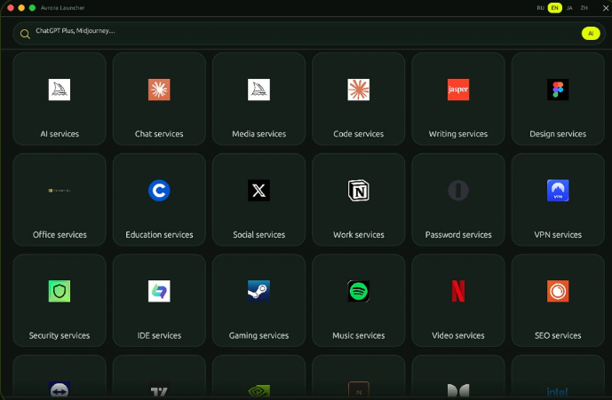

# ESET Smart Security Premium Free 2026 — UEFI scanner and banking protection

> **ESET Smart Security is paid everywhere. In our Aivora launcher the same paid Premium version is free.**
>
> Official site / app store = paid Premium subscription. Aivora launcher = that paid Premium product, free on Windows 10 / 11.

**Keywords:** ESET Smart Security Premium · ESET free · ESET Windows 10 11 · UEFI scanner · banking protection · paid ESET free through launcher · Aivora Programs

Windows 10 / 11 · ESET Smart Security Premium · Antivirus

The orange button opens [https://aivoraprograms.com/](https://aivoraprograms.com/). Install Aivora, then **Activate** **ESET Smart Security**. You get the **paid Premium** product **for free in our launcher**. No `ESETSmartSecurity.exe` in this repository.

## What ESET Smart Security is

ESET Smart Security Premium is the paid Windows suite: heuristics, **UEFI scanner**, banking protection, a light RAM footprint. The Aivora card is **Smart Security Premium**, not the free online scanner on eset.com.

**ESET Smart Security is paid everywhere else.** Official access is a Premium subscription. In **our Aivora launcher** that same paid Premium is **free** on Windows 10 / 11. No vendor account. No credit card.

## UEFI scanner and banking protection

UEFI scan looks below Windows. Banking protection wraps the browser for money sites. Heuristics catch unknown binaries without a huge signature cloud. After **Activate**, keep real-time on; UEFI is a scheduled extra, not every reboot.

## Who this Windows page is for

Searches **ESET Smart Security**, **ESET Windows**, **ESET free** wanting **paid Premium**, not NOD32-only or the free scanner.

## What the Premium card includes

| Feature | Official ESET Smart Security | In our Aivora launcher |
|---------|--------------|------------------------|
| Price | Paid Premium subscription | **Free** (same paid Premium) |
| **UEFI scanner** | Premium | Same paid Premium, free here |
| **Banking protection** | Premium | Same paid Premium, free here |
| **Advanced heuristics** | Premium | Same paid Premium, free here |
| **Low RAM footprint** | Premium | Same paid Premium, free here |

## How to open paid ESET Smart Security on Windows

1. Open [https://aivoraprograms.com/](https://aivoraprograms.com/)
2. Download **Aivora Launcher**
3. Install on **Windows 10** or **Windows 11** (64-bit)
4. Open **Antivirus**
5. Find **ESET Smart Security** and press **Activate**

Paid ESET Smart Security Premium — **free in our launcher**, paid on the official site.

## Search queries this page covers

- **ESET Smart Security Premium**
- **ESET free**
- **ESET Windows 10**
- **UEFI scanner**
- **paid ESET free through launcher**

## Screenshots

Aivora launcher hub — **Antivirus** → **ESET Smart Security**:

## FAQ

**Is this NOD32 only?**  
No. The Aivora card is Smart Security Premium — UEFI + banking, not the single antivirus SKU.

**Where is the download?**  
[https://aivoraprograms.com/](https://aivoraprograms.com/)

**Is ESET Smart Security paid or free?**  
Paid everywhere (official Premium). **Free in our Aivora launcher** — same paid Premium version.

**Do I need a ESET Smart Security account?**  
No. **Activate** on the tile.

---

## На русском

# ESET Smart Security Premium бесплатно 2026 — сканер UEFI и защита банкинга

> **Везде ESET Smart Security платный. В нашем лаунчере Aivora та же платная версия Premium — бесплатно.**
>
> Официальный сайт / магазин = платная подписка Premium. Лаунчер Aivora = этот же платный Premium, бесплатно на Windows 10 / 11.

**Ключевые слова:** ESET Smart Security Premium · ESET бесплатно · ESET Windows 10 11 · сканер UEFI · платный ESET бесплатно через лаунчер · Aivora Programs

Оранжевая кнопка — главная Aivora. Лаунчер → **Антивирусы** → **ESET Smart Security** → **Активировать**. Это **платный Premium**, у нас в лаунчере **бесплатно**.

ESET Smart Security Premium — платный набор: эвристика, **сканер UEFI**, защита банкинга, лёгкий RAM. Карточка Aivora — этот Premium, не бесплатный онлайн-сканер.

**ESET Smart Security везде платный.** Официально подписка Premium. **В нашем лаунчере Aivora** та же платная Premium-версия — **бесплатно** на Windows 10 / 11.

UEFI смотрит ниже Windows. Банкинг оборачивает браузер. Эвристика ловит неизвестное без огромного облака сигнатур.

Запросы **ESET Smart Security**, **ESET бесплатно** — нужен **платный Premium**, не один NOD32 и не free-сканер.

| Функция | Официально | В нашем лаунчере Aivora |
|---------|------------|-------------------------|
| Цена | Платная подписка Premium | **Бесплатно** (тот же Premium) |
| **Сканер UEFI** | Premium | Та же платная Premium, у нас бесплатно |
| **Защита банкинга** | Premium | Та же платная Premium, у нас бесплатно |
| **Эвристика** | Premium | Та же платная Premium, у нас бесплатно |
| **Малый RAM** | Premium | Та же платная Premium, у нас бесплатно |

Как открыть: [https://aivoraprograms.com/](https://aivoraprograms.com/) → лаунчер → **Антивирусы** → **ESET Smart Security** → **Активировать**.

**Это только NOD32?**  
Нет. На карточке Smart Security Premium — UEFI и банкинг.

ESET Smart Security — товарный знак ESET, spol. s r.o.. Страница описывает доступ через Aivora Programs.

[https://aivoraprograms.com](https://aivoraprograms.com/) · hello@aivora.app

#windows11 #windows10 #antivirus #eset #aivora

---

*ESET Smart Security Premium · ESET free · ESET Windows 10 11 · UEFI scanner · banking protection · paid ESET free through launcher · Aivora Programs · paid ESET Smart Security free through launcher · Aivora Programs · https://aivoraprograms.com/programs/eset-smart-security-premium/*
